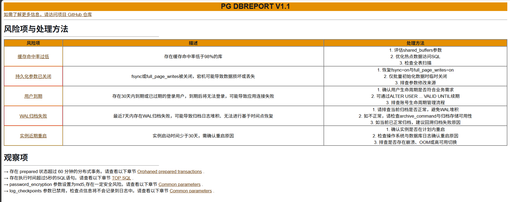
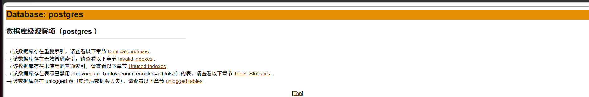

#   PG DBreport

## 特别说明
1- PG DBreport工具基于PG COLLECTOR V3.2创建。
2- 主要功能文件为2个SQL执行脚本pg_dbreport.sql、pg_dbreport_perdb.sql。
3- 生成html格式报告和临时脚本pg_dbreport_dbnav.sql、pg_dbreport_loop.sql默认在/tmp目录。


## 主要改动（Changes to the Original Script）

1. 巡检结果分为实例级和数据库级2部分，并且可以自定义巡检哪些库，默认自动巡检所有数据库。
2. 增加实例级风险告警项和实例级+库级提醒项。
3. 原脚本部分巡检项会罗列所有行，现在大部分限制为罗列20行。
4. 增删了部分巡检项。


## 风险项（Risk Items）

风险项为需要立即关注的问题，达到阈值即触发告警，显示在报告开头的风险项表格中，每项附描述与处理方法，并可跳转到对应详情章节：

| #   | 风险项（Risk Item）          | 触发条件（Trigger Condition）                              | 级别（Level）        |
| --- | ------------ | ---------------------------------- | -------- |
| 1   | 数据库连接数过高     | 连接数超过 max_connections 的 80%（max_connections > 80%） | Critical |
| 2   | 事务ID回卷风险     | 数据库年龄（XID Age）超过 10 亿（XID Age > 10 billion）             | Critical |
| 3   | 复制延迟         | write/flush/replay 任意阶段延迟超过 1 分钟（write/flush/replay > 1 minute）   | Critical |
| 4   | 长事务          | 存在运行超过 1 小时的事务（long running > 1 hour）                     | Warning  |
| 5   | 空闲事务堆积       | 存在 idle in transaction 超过 30 分钟的会话（idle in transaction > 30 minutes） | Warning  |
| 6   | 阻塞会话         | 存在被其他会话阻塞的会话（blocked sessions > 0） | Critical |
| 7   | 缓存命中率过低      | 全库缓存命中率低于 95%（cache hit rate < cache hit rate threshold） | Warning  |
| 8   | 当前Temp文件使用过高 | 当前 temp 文件使用超过 1GB（current temp file usage > 1GB） | Warning  |
| 9   | 持久化参数已关闭     | fsync 或 full_page_writes 未开启（fsync or full_page_writes not enabled） | Critical |
| 10  | 用户即将到期       | 登录用户 30 天内到期或已过期（login user expires in 30 days or has expired） | Warning  |
| 11  | WAL归档失败      | 最近 7 天内存在 WAL 归档失败（WAL archive failures in last 7 days） | Critical |
| 12  | 实例近期重启       | 实例启动时间少于 30 天（instance startup time < 30 days） | Warning  |


## 观察项（Observations）

观察项为建议关注的事项，检测到即显示提示并链接到对应章节详情。

### 实例级（Instance level）

```
    1- 未使用 SSL 加密的连接（Unencrypted connections）
    2- 孤立的预备事务（Orphaned prepared transactions）
    3- 非活动复制槽（Inactive replication slots）
    4- 年龄较高的活动逻辑复制槽（age of catalog_xmin > 3 billion）
    5- 慢查询（slow queries>5 seconds）
    6- 无效数据库（Invalid databases）
    7- 数据库年龄超过 3 亿（XID Age > 3 billion）
    8- autovacuum_freeze_max_age 参数设置为大于 2 亿（autovacuum_freeze_max_age > 2 billion）
    9- 逻辑复制溢出（Logical replication spill files）
   10- autovacuum 参数已禁用（autovacuum=off）
   11- track_counts 参数已禁用（track_counts=off）
   12- enable_indexonlyscan 参数已禁用（enable_indexonlyscan=off）
   13- enable_indexscan 参数已禁用（enable_indexscan=off）
   14- synchronous_commit 参数已禁用（synchronous_commit=off）
   15- log_statement 参数设置为 all 或 mod（log_statement=all or mod）
   16- log_min_duration_statement 参数设置为 0（log_min_duration_statement=0）
   17- password_encryption 参数设置为 md5（password_encryption=md5）
   18- log_checkpoints 参数已禁用（log_checkpoints=off）
```

#   

### 库级（Database level，Per-Database）

```
    1- 重复索引（Duplicate indexes）
    2- 索引膨胀（Index size > 50% of table size）
    3- 无效索引（Invalid indexes）
    4- 未使用索引（Unused indexes）
    5- 剩余值不足 10% 的序列（Sequences with less than 10% remaining values）
    6- 死元组超过 20% 的表（Tables with more than 20% dead rows &table size >10G）
    7- 表级禁用 autovacuum 的表（autovacuum_enabled=off on table level）
    8- 无索引支持的外键（FK without index）
    9- unlogged 表（unlogged tables）
```
#   

##  使用方法

### 1. 下载文件并解压文件。
```
unzip pg_dbreport.zip
```

### 2. 进入解压目录，执行脚本。
```
cd  pg_dbreport

本地巡检：psql -f pg_dbreport.sql

远程巡检（建议使用超级用户连接执行）：psql -h xxx -p xxx -U xxx -d postgres -f pg_dbreport.sql

注意：针对对象多，可能某些查询耗时比较久的情况，可通过以下方式设置超时时间来规避。

PGOPTIONS='-c statement_timeout=30000' psql -f pg_dbreport.sql
PGOPTIONS='-c statement_timeout=30000' psql -h xxx -p xxx -U xxx -d postgres -f pg_dbreport.sql
```

### 3. 下载并通过浏览器查看报告。

## Overview

PG DBreport for [Postgresql](https://www.postgresql.org/) is a sql script that gathers valuable database information and presents it in a consolidated HTML file which provides a convenient way to view and navigate between different sections of the report.

PG DBreport is safe to run on production environments and does not create any database objects to produce the output.

With PG DBreport an operator gains insights on various aspects of the database, such as:

* Database size
* Configuration parameters
* Installed extensions
* Vacuum & Statistics
* Unused Indexes & invalid indexes
* Users & Roles Info
* Fragmentation (Bloat)
* Tablespaces Info
* Memory setting
* Tables and Indexes Size and info
* Transaction ID
* Replication slots
* Unlogged Tables

and more, please check the example reports 

## PG DBreport's Automated Database Health check

The Observations section has been implemented as an automated database health assessment system designed to identify potential database issues and provide actionable recommendations .

The observations section seamlessly integrates with existing PG DBreport report sections, providing cross-references to detailed analysis and supporting data.

more health checks will be added with each new version . 


## Example of PG DBreport report

All Sample reports in [sample report folder](https://github.com/spectershoe/pg-dbreport/tree/main/sample_reports).

## PG DBreport output

### Report name:

PG DBreport script will generate HTML file using the following naming convention pg_dbreport_[DB Name]-[timestamp].html .

[DB Name] : is the database name that you are connected to.

```
Example :  pg_dbreport_postgres-2026-10-14_112720.html
```

### Report location:

PG DBreport script will generate HTML file  under [/tmp](https://tldp.org/LDP/Linux-Filesystem-Hierarchy/html/tmp.html) directory. 

## How to run PG DBreport script ( pg_dbreport.sql )

1- you need [psql](https://www.postgresql.org/docs/current/app-psql.html) to be able to connect to the postgresql DB and run the pg_dbreport.sql script 

2- Download pg_dbreport.sql and pg_dbreport_perdb.sql in your laptop or the host that want to access the database from 

3- login to the database using psql 

```
psql -h [hostname or RDS endpoint] -p [Port] -d [Database name ] -U [user name] 
```

4- run the pg_dbreport.sql script 

```
\i pg_dbreport.sql 
\q
```

or use -f option in psql 

```
psql -h [hostname or RDS endpoint] -p [Port] -d [Database name ] -U [user name] -f pg_dbreport.sql 
```

Example :

```
[postgres@10-10-180-197 ~]$ psql -f pg_dbreport.sql
Output format is html.
Output format is unaligned.
Output format is html.
You are now connected to database "db2" as user "postgres".
You are now connected to database "postgres" as user "postgres".
You are now connected to database "shoedb" as user "postgres".
You are now connected to database "tpcc" as user "postgres".
巡检完成，报告已生成: /tmp/pg_dbreport_postgres-2026-10-14_154743.html
[postgres@10-10-180-197 ~]$
[postgres@10-10-180-197 ~]$ ls -l /tmp/pg_dbreport_postgres-2026-10-14_154743.html
-rw-rw-r-- 1 postgres postgres 430563 Oct 14 15:47 /tmp/pg_dbreport_postgres-2026-10-14_154743.html
[postgres@10-10-180-197 ~]$

```

5-  open the report using any internet browser

## Notes:

1- If the Database have Tens of thousands of tables , some queries can take longer time .
use statement_timeout to Abort any statement that takes more than the specified number of milliseconds.
please check below example .  

```
PGOPTIONS='-c statement_timeout=30000' psql -h xxx -U xxx -d postgres -f pg_dbreport.sql
```

# License

This library is licensed under the MIT-0 License. See the LICENSE file.
